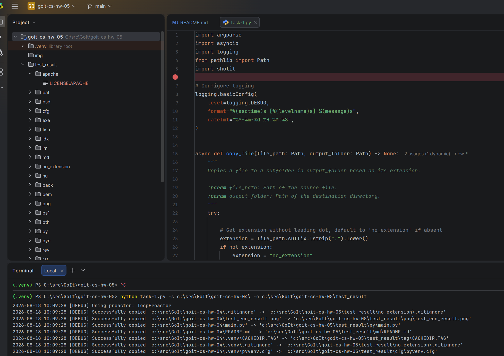
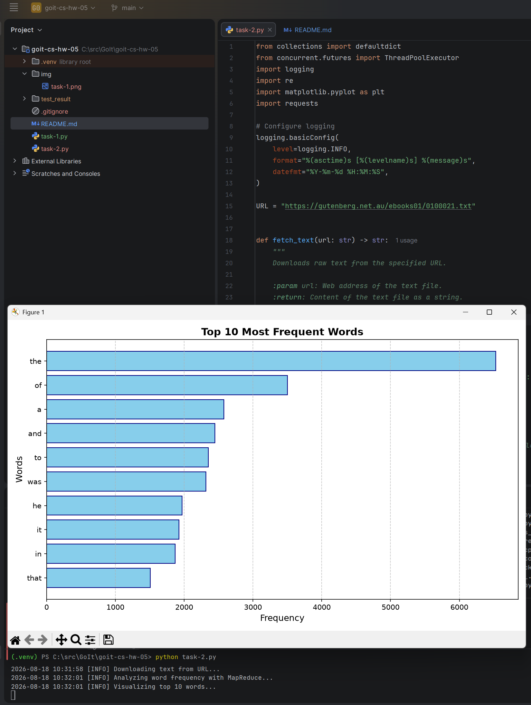

# goit-cs-hw-05 Домашнє завдання до модуля “Асинхронна обробка”
## Завдання 1

### Рішення
1. **Аргументи командного рядка (`argparse`)**: Скрипт приймає шлях до вихідної папки (`-s` / `--source`) та цільової папки (`-o` / `--output`).
2. **Рекурсивне асинхронне читання (`read_folder`)**: Функція отримує вміст директорії та створює асинхронні задачі: для кожної підпапки рекурсивно викликається `read_folder`, а для кожного файлу — `copy_file`. Всі задачі виконуються паралельно через `asyncio.gather()`.
3. **Сортування та копіювання файлів (`copy_file`)**: Файл аналізується на наявність розширення (файли без розширення потрапляють до папки `no_extension`). Створюється відповідна підпапка у цільовій директорії, файл копіюється за допомогою `shutil.copyfile`.
4. **Асинхронні I/O-операції (`asyncio.to_thread`)**: Операції з файловою системою (`iterdir`, `mkdir`, `copyfile`) виконуються у фонових потоках за допомогою `asyncio.to_thread`, що запобігає блокуванню головного подійного циклу (`event loop`) та забезпечує сумісність із версіями Python 3.8+.
5. **Логування та обробка помилок (`logging`)**: Усі винятки при обході чи копіюванні обробляються блоками `try...except` та фіксуються в логах, а перебіг виконання відображається у консолі.

```console
python task-1.py -s c:\src\GoIt\goit-cs-hw-04\ -o c:\src\GoIt\goit-cs-hw-05\test_result
```

<br />
<a href="img/task-1.png">
  
</a>

## Завдання 2
### Рішення

1. **Завантаження тексту**: функція fetch_text використовує бібліотеку requests для завантаження тексту з URL ("https://gutenberg.net.au/ebooks01/0100021.txt").
2. **Парадигма MapReduce з багатопотоковістю (ThreadPoolExecutor)**:
- Map phase (map_mapper): розбиває фрагменти тексту на окремі слова та формує пари (word, 1).
- Shuffle phase (shuffle_function): групує масив результатів за словами (word -> [1, 1, 1...]).
- Reduce phase (reduce_key_value): підраховує сумарну кількість входжень кожного слова.
3. **Візуалізація (visualize_top_words)**: побудова горизонтального стовпчастого графіка (Horizontal Bar Chart) за допомогою matplotlib.pyplot.barh.

```console
python task-2.py
```

<br />
<a href="img/task-2.png">
  
</a>